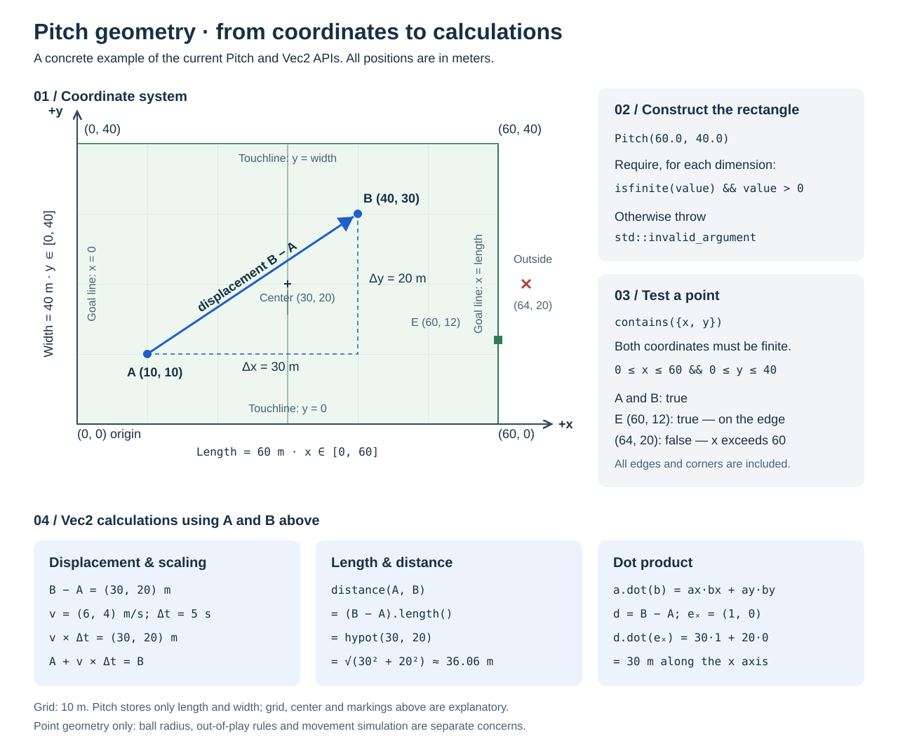

# Match engine

The frame every match system runs in: the pitch and its coordinates, the
validated match state, the fixed-timestep loop with its commands and systems,
the events a step publishes, and how play restarts after the ball goes out.

- [Header layers](#header-layers)
- [Match geometry](#match-geometry)
- [Match state](#match-state)
- [Match loop](#match-loop)
- [Match events and decision diagnostics](#match-events-and-decision-diagnostics)
- [Restarts](#restarts)

## Header layers

The public headers of `sim-match` form five layers. A header includes
`sim-match` headers of its own layer or a lower one only, so the match state
knows nothing of the systems that change it, and the loop nothing of the
systems it runs:

| Layer     | What it holds                                                    | Headers, for example                                  |
|-----------|------------------------------------------------------------------|-------------------------------------------------------|
| model     | the match state and its parts, events, commands, candidate types | `matchState.hpp`, `matchEvents.hpp`, `passCandidate.hpp` |
| mechanics | pure physics, geometry and execution, spatial queries            | `ballPhysics.hpp`, `passing.hpp`, `reception.hpp`     |
| loop      | the fixed-timestep loop and the interface of its systems         | `matchSimulation.hpp`                                 |
| behaviour | the decisions and the systems that run them                      | `passDecision.hpp`, `ballMovement.hpp`, `duel.hpp`    |
| setup     | configuration and fixtures that put whole matches together       | `matchSetup.hpp`, `scenarios.hpp`                     |

`tests/architecture/headerLayers.cmake` lists every header's layer and fails
the `sim-match-header-layers` test for a header that includes one above its
own, or that belongs to no layer: a new header needs its layer there. Sources
under `src/` may include anything.

A type an event carries belongs with the events, even when one system makes
it: the goalkeeper's `SweepCall` and the aerial duel's `AerialPlay` are model,
so the loop, which records events, does not depend on the goalkeeper or the
aerial duels.

Systems share one shape. A factory `make…System()` takes the system's own
configuration, or a `…Rules` struct when it needs more than one, whose fields
default to the standard configuration. The time a rule needs is a
`SimCore::StepTime`, which `MatchStepContext::time()` hands out. A system with
many steps plays them as const methods of one object that holds the rules, the
context, the state and the writer for the step, as `BallTick` and `DuelStep`
do, rather than passing all four from function to function.

## Match geometry

`sim-match` is a standard C++23 static library with no Unreal dependency.
Consumers link `ElyverseFootball::sim-match` and include `pitch.hpp`.
The reusable `Vec2` value type lives in `sim-core` (`vec2.hpp`).

### Illustrated example



[Editable vector drawing](images/pitch-geometry.svg) · [PNG version](images/pitch-geometry.png)

The example connects `A = (10, 10)` to `B = (40, 30)`: the displacement is
`(30, 20)` meters, its `length()` about 36.06 meters. A velocity of `(6, 4)`
m/s over five seconds gives the same displacement.

`Pitch` stores only the two dimensions; the drawing's grid lines, markings and
points illustrate the coordinate system, and the markings are derived on
demand. Boundary checks include the edge and reject a point beyond it, without
ball radius or football rules.

### Coordinate system

- Positions and pitch dimensions are measured in meters.
- The origin `(0, 0)` is one corner of the pitch.
- The x axis follows the pitch length; goal lines are at `x = 0` and `x = length`.
- The y axis follows the pitch width; touchlines are at `y = 0` and `y = width`.
- The center is `(length / 2, width / 2)`.
- Coordinates belong to the teams: home defends `x = 0` in both halves, and
  when the teams change ends only a view turns the pitch round
  ([halves](match-clock.md#halves)). Renderers map these coordinates to their
  own screen axes.

`Pitch(60.0, 40.0)` creates a 60 by 40 meter rectangle (example dimensions,
not a mandated 7v7 size). Both dimensions must be positive and finite, or it
throws `std::invalid_argument`. Two `Pitch` values are equal when both
dimensions match exactly, without tolerance.

`Pitch::contains()` includes edges and corners, without an implicit epsilon, and
is false for NaN or infinity. It tests a point, not the ball: ball radius and
out-of-play rules are not part of this API.

`Pitch::clamp()` returns the point on the pitch nearest to a finite position:
the position itself when `contains()` holds, otherwise its projection onto the
nearest edge or corner. Movement commands use it to keep targets on the pitch.

### Named sizes

Two sizes are named; any positive, finite pair of dimensions builds a pitch.

- `kStandardLengthMeters` (105) and `kStandardWidthMeters` (68): standard
  eleven-a-side dimensions, the reference pitch the Laws of the Game state every
  marking for.
- `kSandboxLengthMeters` (60) and `kSandboxWidthMeters` (40): the sandbox size
  the seven-a-side fixtures and scenarios play on -- small enough to read in the
  debug viewer, not a mandated 7v7 size.

### Markings

`Pitch::markings()` derives every marking's lengths, in meters, from the two
dimensions alone, so `operator==` compares only the dimensions. The Laws fix
every marking and give a range only for the pitch, so the dimensions are all
there is to configure. `kStandardMarkings` holds the Laws' numbers, which a
pitch of another size scales:

| Marking | At the standard pitch | Scales with |
| --- | --- | --- |
| `goalWidthMeters` | 7.32 | the width |
| `goalHeightMeters` | 2.44 | the width |
| `penaltyAreaDepthMeters` | 16.5 | the length |
| `penaltyAreaWidthMeters` | 40.32 | the width |
| `goalAreaDepthMeters` | 5.5 | the length |
| `goalAreaWidthMeters` | 18.32 | the width |
| `penaltySpotDistanceMeters` | 11 | the length |
| `centerCircleRadiusMeters` | 9.15 | the smaller factor |
| `cornerArcRadiusMeters` | 1 | the smaller factor |

The penalty area is 16.5 meters deep and reaches 16.5 meters to either side of
the goal (16.5 + 7.32 + 16.5 = 40.32); the goal area does the same with 5.5
(5.5 + 7.32 + 5.5 = 18.32).

Depths scale with the length, widths with the width, and the two radii with
the smaller factor, so a circle stays a circle. Every standard marking is
smaller than the standard pitch in its direction, so every derived marking fits
its pitch: the 60 × 40 m sandbox gets a 4.31 × 1.44 m goal, a penalty area
9.43 m deep and 23.72 m wide, and a center circle of radius 5.23 m. At 105 × 68
both factors are exactly one, so the markings are the Laws' numbers bit for
bit.

Markings are geometry, not rules: no line is a boundary by itself. Goals are
[shooting](on-ball.md#goals); [offside](#offside) and [penalties](fouls.md)
are rules of their own.

### Goals, areas, spots and arcs

Both goals are named by the goal line they stand on, `GoalEnd::kMinX` for
`x = 0` and `GoalEnd::kMaxX` for `x = length`. Home defends `kMinX` and away
`kMaxX` in both halves ([halves](match-clock.md#halves)); `ownGoalEnd()` says
which, rather than an end itself.

- `goalLineX(end)` is 0 or the length; `center()` is the middle of the pitch.
- `goal(end)` is the frame: the middle between the posts on the goal line, the width
  between the posts, and the height to the underside of the crossbar.
  `postAtMinY()` and `postAtMaxY()` are the two posts, at the lower and the
  higher pitch y. Posts and crossbar have no thickness of their own.
- `penaltyArea(end)` and `goalArea(end)` are `PitchRect`s reaching from the goal
  line into the pitch, centered on the goal; `penaltySpot(end)` lies on the
  goal's center line.
- `centerCircle()` is a `PitchCircle`. `cornerArc(corner)` is the full circle
  the arc is a quarter of: a position is in the arc when it is inside that
  circle and on the pitch. `PitchCorner` names a corner by the goal line and the
  touchline it lies on, `cornerPosition(corner)` gives the corner itself.

`PitchCircle::contains()` includes the edge and rejects non-finite points, like
`PitchRect::contains()` and `Pitch::contains()`. It compares the offset's
`length()` with the radius, not their squares, so it stays correct where
squaring would overflow or underflow. Heights are meters above the ground; the
geometry stores none — callers supply the height, and the ball carries its own
([ball movement](ball.md#ball-movement)).

`Goal::framesPoint(pitchY, height)` is true inside the frame: both
`isBetweenPosts()` and `isUnderCrossbar()` hold. Edges count — a point on a post
or under the crossbar is framed. Whether a ball crossed the line, and which way,
is for shot code.

### Distance and open angle to a goal

Three helpers exist for shot and goalkeeper code:

- `isInPenaltyArea(end, position)` includes the area's lines, like every other
  containment check here, and is false for a non-finite position.
- `distanceToGoalMeters(end, position)` is the distance to the nearest point of
  the goal -- the line between the posts, not its center -- so it is zero
  between the posts and runs to the nearer post from beside it. A non-finite
  position gives a non-finite distance.
- `goalAngleRadians(end, position)` is the angle in `[0, pi]` that the goal
  subtends at a position: how much goal there is to shoot at. It is widest in
  front of the center, narrows toward the posts and with distance, is `pi`
  between the posts and zero on a post or for a non-finite position. It
  is the open angle of an empty pitch -- nobody blocks it -- and a position
  behind the goal line gets the same angle as its mirror image, so callers check
  where they stand themselves.

### Stable math

Standard math functions such as `std::atan2`, `std::hypot`, `std::exp` and
`std::cos` need not be correctly rounded; a last-bit difference between machines
can make a replay diverge. `sim-core` therefore provides its own, built from
correctly rounded arithmetic and `std::sqrt`: the angle uses
`SimCore::stableArcTangent()` (accurate to a few units in the last place).
`Vec2::length()` — and with it `SimCore::distance()`, the goal distance and the
circles' containment — uses `SimCore::stableHypot()`: exactly
`std::sqrt(x * x + y * y)` where the squares are safe, scaled by an exact power
of two first where they would overflow or underflow.

`SimCore::stableSine()`, `stableCosine()` and `stableSineCosine()`, which
returns both from one range reduction, turn a velocity by an angle. They reduce
the angle's magnitude by quarter turns (Cody-Waite, pi/2 split into three exact
parts and a tail), sum the Taylor series of sine and cosine within a quarter
turn either side of zero, all in correctly rounded arithmetic, and give the sine
the angle's sign, so the sine is exactly odd and the cosine exactly even: a turn
to the left mirrors one to the right bit for bit. Measured against the standard
library and pinned by the tests, both at a value and as a hash over a dense
sweep that any changed last bit breaks:

| Angle                                         | Accuracy                                  |
|-----------------------------------------------|-------------------------------------------|
| within ±pi/4                                  | 2 · ε · the true value                    |
| up to `kMaxStableAngle`, 2^20 · pi/2 (1.6 · 10⁶ rad) | 2 · ε, two units in the last place of 1 |

Beyond `kMaxStableAngle` the reduction would no longer be exact, so both are
NaN, as for a non-finite angle; the simulation turns by a few radians at most.

### Vector operations

`Vec2` holds two doubles by value, zero by default: addition, subtraction,
scalar multiplication, dot product, length, squared length, distance and
`isFinite()`. Units follow the context: meters for a position, meters per
second for a velocity; velocity times seconds is displacement.

Equality compares components exactly; tolerance checks need an explicit,
context-specific tolerance. Extreme inputs can give non-finite results, which
`isFinite()` detects. `length()` uses `SimCore::stableHypot()`.

`lengthSquared()` is the squared magnitude, in squared units: compare it with a
squared threshold, never a length. It orders magnitudes exactly like
`length()`, is exact where `length()` rounds, and can overflow to infinity for
extreme inputs.

The primitives draw no random numbers and use only correctly rounded
operations, so their results are the same on every platform the project builds
on (the build turns off floating-point contraction).

## Match state

`MatchState` is the smallest complete picture of a match: a pitch, two teams of
players, and one ball. It is in `sim-match` (`matchState.hpp`,
`kickoffScenario.hpp`) and depends on `sim-core` and, for the tactics sides
play, `sim-tactics`. Nothing here advances time: the
[match loop](#match-loop) reads and writes the state.

### What a state holds

| Type               | Contents                                                                        |
|--------------------|---------------------------------------------------------------------------------|
| `MatchState`       | the `Pitch`, the players in order, the `BallState`, the squad size per side, every player's perception memory, each side's tactic, the [match clock](match-clock.md), the play the [offside](#offside) rule watches, and the last [foul](fouls.md) |
| `PlayerMatchState` | `playerId`, `side`, `position`, `velocity`, `attributes`, `target`, `facing`, `fitness` ([fitness](players.md#fitness)), `yellowCards`, `sentOff` ([cards](fouls.md#cards)) |
| `PlayerAttributes` | fixed for the match; see below                                                   |
| `BallState`        | `position`, `velocity`, `height`, `verticalVelocity`, `spin`, `sideSpin`, `owner`, `lastTouch`, `held`, `touch` |
| `TeamSide`         | `kHome` or `kAway`                                                              |

Positions are meters and velocities meters per second, in the plane of
[match geometry](#match-geometry). The coordinates are fixed, so `TeamSide`
names a squad, not its direction: home defends `x = 0` and attacks `+x` in
every match and both halves. Systems take the direction from
`attackingDirection()`. When the teams change ends at half time, the frame stays
with them; only a view turns the pitch round
([halves](match-clock.md#halves)).

`target` is where the player is moving to; empty until a command sets one, and
without one he stops ([player movement](players.md#player-movement)). `facing`
is the unit vector he looks along and decides what he sees; a vector, not an
angle, so no trigonometry enters the state. The kickoff fixture turns each side
toward the goal it attacks.

`PlayerAttributes` describe the sandbox's predefined test players, not
generated ones. All skills lie in [0, 1]:

| Attribute | Default | Used by |
|-----------|---------|---------|
| `maxSpeed`, `acceleration` | 7.5 m/s, 4 m/s² (`kDefaultMaxSpeed`, `kDefaultAcceleration`) | [player movement](players.md#player-movement) |
| `shotAccuracy` | 0.5, an average finisher | [shot decisions](on-ball.md#shot-decisions) |
| `shotTechnique`, `weakFootAccuracy`, `strongFoot` | 0.5, 0.5, right | [shooting](on-ball.md#shooting) |
| `keeperPositioning`, `keeperAnticipation` | 0.5 | [goalkeeper](goalkeeper.md#positioning-and-sweeping); anticipation also reads a shot |
| `keeperReflexes`, `keeperHandling` | 0.5 | [shot stopping](goalkeeper.md#shot-stopping) |
| `jumping`, `heading`, `strength` | 0.5 | [aerial duels](duels.md#aerial-duels-and-headers); strength also [duels](duels.md#duels-on-the-ball) |
| `ballControl`, `dribbling` | 0.5 | [ball carrying](on-ball.md#ball-carrying); ball control also [duels](duels.md#duels-on-the-ball) |
| `decisionMaking` | 0.5 (`kDefaultDecisionMaking`) | [decision-making](on-ball.md#decision-making): how reliably he picks and how well he estimates on the ball |

The ball's `owner` controls it, empty while free; `lastTouch` is the last player
to kick or take it ([possession](ball.md#possession)). `held` means the owner
holds it in his hands, a goalkeeper who took it with them
([goalkeeper distribution](goalkeeper.md#distribution)); only an owned ball can
be held, and a new owner has it at his feet until the ball system puts it in his
hands. `touch` is the owner's touch while the ball rolls ahead of him
([ball carrying](on-ball.md#ball-carrying)); only an owned ball at the feet can
be touched on. `height` and `verticalVelocity` (meters, m/s), `spin` (top-
or backspin, rad/s) and `sideSpin` (rad/s, curling left when positive,
[curve](ball.md#curve)) are its third dimension ([ball movement](ball.md#ball-movement)).
Validation rejects a non-finite height, a ball below the ground, and a vertical
velocity or either spin that is not finite or beyond `kMaxBallSpeed` and
`kMaxBallSpin`.

Every player has a slot for an action he has decided and not yet done,
`pendingAction(index)`: a pass ([passing](on-ball.md#passing)), a shot
([shot decisions](on-ball.md#shot-decisions)) or a touch to turn, carry or
dribble ([ball carrying](on-ball.md#ball-carrying)). Only the player on the ball
decides one; `pendingPass()` finds the waiting pass.

Each side plays a [tactic](tactics.md#tactic-model) or none:
`MatchState::create(spec, tactics)` takes them as `TeamTactics { home, away }`,
both empty by default. A side without a tactic is scripted: its players move
only on commands and after free balls, as in the P1 sandbox. A tactic needs one
slot per player of its side (`kTacticDoesNotFitSquad` otherwise); the player in
slot `i` is the `i`-th of his side in `players()`, and
`slotIndex(state, playerIndex)` finds it. The state hash includes each tactic
by its content hash.

The systems keep their results in the state too:

| Accessor | Holds | Written by |
|----------|-------|------------|
| `possession()`, `phase(side)` | which team has the ball, since when and whether from the opponent; each side's tactical phase | [match phases](team-tactics.md#match-phases) |
| `pitchControl()` | the latest grid | [pitch control](team-tactics.md#pitch-control) |
| `chaser(side)` | the player each side sends after a free ball | [reception](ball.md#reception-interceptions-and-loose-balls) |
| `tactical(playerIndex)` | a player's runtime state: [desired region](team-tactics.md#desired-region), a goalkeeper's [dive](goalkeeper.md#shot-stopping), his last [jump](duels.md#aerial-duels-and-headers), a defender's [duel](duels.md#duels-on-the-ball) and how long he is off his feet | several systems |
| `press(side)` | the side's [press](team-tactics.md#pressing) in progress | team pressing |
| `lastPass()`, `lastShot()`, `lastReception()`, `lastGoal()` | the last pass kicked; the last shot, with the player it came off, whether its outcome is recorded and the keeper's parry ([shot stopping](goalkeeper.md#shot-stopping)); the last free ball controlled, with the teammate whose pass it was; the last goal | the ball system |
| `perception(playerIndex)` | what he believes about the ball and the others ([perception](players.md#perception)) | perception |

All are empty in a state created from a spec; perception is built up by the
match, so neither the spec nor the replay format has a field for it. The state
hash includes them all.

`score()` is the goals both sides have scored. A spec states the starting
score, 0:0 by default and never negative (`kInvalidScore`); the
[ball system](on-ball.md#goals) counts from there.

Energy and the other fields of [implementation plan](implementation-plan.md)
section 6.2 come with the systems that fill them.

Player order is part of the state: two states with the same players in a
different order are not equal, because a replay needs a fixed update order.

### Construction is validation

`MatchState::create(MatchStateSpec)` is the only way to obtain a `MatchState`
from outside the simulation, so every instance that exists has passed every rule
below. It returns `std::expected<MatchState, std::vector<MatchStateError>>`: on
success the state, on failure every rule the spec breaks, not just the first
one.

| Rule                                              | Error code                 |
|---------------------------------------------------|----------------------------|
| `playersPerSide` is at least 1                    | `kInvalidPlayersPerSide`   |
| each side fields exactly `playersPerSide` players | `kWrongPlayerCountPerSide` |
| every player's side is home or away               | `kInvalidTeamSide`         |
| every player has a valid id                       | `kInvalidPlayerId`         |
| player ids are unique                             | `kDuplicatePlayerId`       |
| player attributes are positive and finite         | `kInvalidPlayerAttributes` |
| player positions are finite                       | `kNonFinitePlayerPosition` |
| player velocities are finite                      | `kNonFinitePlayerVelocity` |
| no player moves faster than his max speed         | `kPlayerTooFast`           |
| player targets, where set, are finite             | `kNonFinitePlayerTarget`   |
| player facings are finite unit vectors            | `kInvalidPlayerFacing`     |
| the ball position is finite                       | `kNonFiniteBallPosition`   |
| the ball velocity is finite                       | `kNonFiniteBallVelocity`   |
| the ball is not faster than `kMaxBallSpeed` (100 m/s) | `kBallTooFast`         |
| the ball's owner, where set, is a player in the state | `kUnknownBallOwner`    |
| the ball's last touch, where set, is a player in the state | `kUnknownLastTouch` |
| a held ball has an owner                          | `kHeldBallWithoutOwner`    |
| a held ball is in its side's goalkeeper's hands   | `kHeldBallByOutfielder`    |
| a ball touched on has an owner                    | `kTouchedBallWithoutOwner` |
| a ball touched on is not held, its seconds finite and not negative | `kInvalidCarryTouch` |

These rules hold for every state of a match, from kickoff to the final whistle.
The match loop only changes positions, velocities, targets and facings, and
checks the state it writes with `findNonFiniteValues(const MatchState&)`, which
applies the five finiteness rules and the facing rule with the same codes and
messages as `create()`. A facing counts as a unit vector when its squared length
is within `kFacingTolerance` (1e-9) of one.
Being on the pitch is deliberately not one of them: a ball that crossed the
touchline or a player standing behind the goal line is football, not a broken
state. Deciding what such a position means — a throw-in, a goal kick, a goal —
belongs to the rules system, not to validation.

### Starting positions

A state a match starts from, such as the kickoff fixture below, must also have
everyone on the pitch. `checkStartingPositions(const MatchState&)` checks that
and returns one error per offender, players by index and then the ball, or an
empty list:

| Rule                              | Error code            |
|-----------------------------------|-----------------------|
| player positions are on the pitch | `kPlayerOutsidePitch` |
| the ball is on the pitch          | `kBallOutsidePitch`   |

### Error messages

Errors arrive in a fixed order — squad size, then players by index, then the
ball — so a rejection reads the same way on every run and on every platform.
Each error carries a message naming the details its rule needs: the side
counts for a squad-size error, the player's index, id, and side plus the
offending value for a player error, and the offending value for a ball error:

```text
home has 7 players and away has 6, expected 7 per side
duplicate player id 4 at index 8, first seen at index 3
player at index 4 (id 5, home) is outside the 60 x 40 m pitch at (60.00000000000001, 20) m
```

Numbers are printed in their shortest round-trippable form (`std::format("{}")`),
not with a fixed precision. The boundary is inclusive, so a player at exactly
60 m is on the pitch; the example above is one ulp past the touchline, and a
fixed two-decimal format would have printed it as a point on the line. The
output is locale-independent, so messages match on every platform.

One defect produces one error. An invalid id is not also counted as a
duplicate of the next invalid one, and a player with an undeclared side does
not also break the squad-size rule when assigning it a side could satisfy it.

Squad size is checked per side rather than as a total, because the total
follows from the two side counts. `playersPerSide` defaults to
`kDefaultPlayersPerSide` (7), the sandbox of short scenarios; eleven a side is
the same type with a different argument
([the eleven-a-side kickoff fixture](#the-eleven-a-side-kickoff-fixture)).

### The seven-a-side kickoff fixture

`makeSevenASideKickoff(pitch, ballVelocity = {})` builds the fixed starting
scenario. It is a pure function of its arguments: no seed, no random number
generator, no clock. The same arguments always produce the same state, which is
what makes it usable as the `InitialSnapshot` of a replay
([implementation plan](implementation-plan.md) section 5.3).

Home defends `x = 0` and attacks `+x`. Positions are fractions of the pitch
dimensions rather than fixed meters, so the fixture fits any valid pitch:

| Id   | Side | Role            | x             | y            |
|------|------|-----------------|---------------|--------------|
| 1    | home | goalkeeper      | 0.05 · length | 0.50 · width |
| 2    | home | left back       | 0.22 · length | 0.22 · width |
| 3    | home | right back      | 0.22 · length | 0.78 · width |
| 4    | home | center midfield | 0.35 · length | 0.50 · width |
| 5    | home | left midfield   | 0.42 · length | 0.25 · width |
| 6    | home | right midfield  | 0.42 · length | 0.75 · width |
| 7    | home | forward         | 0.47 · length | 0.50 · width |
| 8–14 | away | mirror of 1–7   | length − x    | unchanged    |

Away is home's mirror image through the halfway line, so each side starts in
its own half. The ball lies on the center spot and every player velocity is
zero. The ball is at rest unless the optional `ballVelocity` argument sets it
rolling; see [ball movement](ball.md#ball-movement).
Role names describe the layout; they are not a field of the state, because
responsibilities belong to the tactics module.

Every fraction lies strictly between zero and one, so the fixture cannot fall
outside the pitch it was built for. It still goes through
`MatchState::create()` and `checkStartingPositions()`, so there is exactly one
validated way to build a state and the fixture is held to the same rules as any
other starting state.

The unit tests pin the resulting coordinates. Changing a fraction changes the
fixture, and a changed fixture invalidates every replay recorded against it —
treat the table above as a contract, not a default.

### The eleven-a-side kickoff fixture

`makeElevenASideKickoff(pitch, ballVelocity = {}, tactics = {})` is the same
fixture for eleven a side, made for the standard 105 × 68 m pitch but fitting
any: a 4-4-2 in each half, ids 1 to 11 for home and 12 to 22 for away, away the
mirror image of home, everyone at rest facing the goal he attacks, the ball on
the centre spot.

| Id    | Role                | x             | y            |
|-------|---------------------|---------------|--------------|
| 1     | goalkeeper          | 0.04 · length | 0.50 · width |
| 2–5   | the back four       | 0.18, 0.16, 0.16, 0.18 · length | 0.12, 0.38, 0.62, 0.88 · width |
| 6–9   | the midfield four   | 0.32, 0.30, 0.30, 0.32 · length | 0.12, 0.38, 0.62, 0.88 · width |
| 10    | forward             | 0.44 · length | 0.40 · width |
| 11    | forward             | 0.47 · length | 0.55 · width |
| 12–22 | mirror of 1–11      | length − x    | unchanged    |

Like the seven-a-side fixture it goes through `MatchState::create()` and
`checkStartingPositions()`, and its coordinates are a contract. Nothing else in
the simulation assumes a squad size: every system takes the count from the
state (`playersPerSide()`).

### What this is not

- The state does not advance itself; the [match loop](#match-loop) has the
  clock, and movement and ball physics are systems in it.
- It holds no rules: no offside, no fouls. A player on the goal line, or a ball
  behind it, is a valid state; the systems decide what it means.

## Match loop

`MatchSimulation` advances a match in fixed time steps. It is in `sim-match`
(`matchSimulation.hpp`), works on the [match state](#match-state) and depends
only on `sim-core`. The loop owns time, update order and the rules every system
follows; it moves nobody itself — movement, ball physics, perception and
decisions are systems in it.

### One step, one tick

`step()` advances the match by exactly one tick. It takes no argument — no
delta time, no timestamp — so time moves only through `step()`. How often a
caller steps changes how fast a match plays on screen, never what happens: live,
fast-forwarded or headless give the same match.

The tick rate is a setting of `MatchSimulationSpec`, 30 Hz by default
(`kDefaultTicksPerSecond`). Elapsed time is `tick / ticksPerSecond`, one correctly
rounded division, so 300 ticks at 30 Hz are exactly 10 seconds.

| Accessor           | Meaning                                                     |
|--------------------|-------------------------------------------------------------|
| `tick()`           | ticks completed since the start                             |
| `elapsedSeconds()` | simulation time in seconds                                  |
| `state()`          | the state after the last step                               |
| `previousState()`  | the state before the last step; equal to `state()` at first |

A presentation layer interpolates between `previousState()` and `state()` to
render at any frame rate.

### What happens in a step

A step from tick `t` to `t + 1`:

1. Applies the commands scheduled for tick `t`, in scheduling order.
2. Copies the resulting state into the next one.
3. Runs every system due at `t`, in the order the spec lists them. Each system
   reads the current state, commands included, and writes the next one.
4. After each system, checks the next state for non-finite values.
5. Advances the clock and makes the next state current.

After the clock advances, the events the step recorded are published: see
[match events](#match-events-and-decision-diagnostics).

### Commands

A command is an intent from outside the systems — a scenario script, a coach, a
test — that changes the state at a tick. `MatchCommand` is a `std::variant` of
the command types:

| Command             | Effect                                                                |
|---------------------|-----------------------------------------------------------------------|
| `MovePlayerCommand` | sets a player's movement target, moved onto the pitch if it lies off it |
| `GiveBallCommand`   | puts the ball at a player's feet; he owns it from this step on        |
| `PassCommand`       | asks a player to pass; played in this step if he owns the ball       |
| `ChangeTacticCommand` | switches a side to another tactic from this step on               |

`schedule(ScheduledCommand)` queues a command for the step that starts at its
tick; a command for `tick()` itself applies in the next step. Commands of one
tick apply in scheduling order, the explicit order a replay needs. `schedule()`
rejects a tick before `tick()`, an unknown player, a non-finite target and a
tactic that does not fit the squad, and leaves the queue unchanged. Commands
known before kickoff go into `MatchSimulationSpec::commands`; the constructor
schedules them in order and throws `std::invalid_argument` for an invalid one.

`appliedCommands()` returns every command applied so far, in order: with the
initial state, seed and tick rate, the ordered command log of the replay
contract. Commands apply to a copy of the current state, so a failed step leaves
`state()` and the log unchanged.

#### Tactic changes

A coach, the AI and a test all change a tactic the same way: a
`ChangeTacticCommand` with the side and the new, validated tactic. So every
change is in the command log, and a replay reproduces it, tactic content
included. It applies at the start of its tick's step and records a
`TacticChanged` event with the tactic's name and content hash. The side's phase,
press and the players' tactical state stay; each system follows the new tactic
at its next update, the tactical phase within a third of a second. A side
without a tactic plays the new one from then on.

### Systems

A `MatchSystem` has a unique `name`, an `update` function, and a schedule:

```cpp
using MatchSystemUpdate = std::function<void(
    const MatchStepContext& context, const MatchState& current, MatchStateWriter& next)>;
```

**Read current, write next.** A player is never updated against positions
other players already moved to in the same step: the tenth player and the first
see the same pitch. Update order is fixed, so replays reproduce. Each field
should have exactly one system that writes it. Where a later system must see an
earlier one's write in the same step — a stumble from the duel system, for
instance — it reads the writer instead of `current`.

**Write only what a match changes.** `MatchStateWriter` sets what systems change
— positions, velocities, targets, facings, perception, the ball, pending
actions, tactical state, phases, presses, records and the score. Squad, ids,
sides, attributes, player order and the pitch have no setter, so no system can
break those invariants. Players are addressed by their index in
`MatchState::players()`.

**Keep no state of your own.** Everything that must survive a tick belongs in
the match state; only then does a copy of a simulation continue exactly like
the original.

**Schedule.** A system runs in the steps whose tick satisfies
`t % intervalTicks == phaseTicks`. The default, interval 1 and phase 0, runs it
every tick. At 30 Hz:

| Rate  | Interval | Example             |
|-------|----------|---------------------|
| 30 Hz | 1        | movement            |
| 10 Hz | 3        | perception          |
| 5 Hz  | 6        | decisions           |
| 2 Hz  | 15       | tactical evaluation |

Different phases spread systems of one rate over different ticks. In a skipped
step, a system's fields keep their values. Rates are whole numbers of ticks, so
the schedule stays exact over a whole match.

**Randomness.** `context.random(domain)` returns the simulation's stream for a
`RandomNumberGeneratorDomain`, derived from the spec's seed with
`deriveSeed()`. Systems draw in their fixed order, so the draws are part of what
a replay reproduces.

### The standard systems

`matchSetup.hpp` assembles the systems a real match runs. `MatchConfig` holds
every tunable parameter of those systems, and `makeMatchSystems(config)` returns
them in their fixed order. Each system's factory takes its configuration, or a
`…Rules` struct when it needs more ([header layers](#header-layers)):

| Order | System          | Rate       | Writes                         |
|-------|-----------------|------------|--------------------------------|
| 1     | perception      | 10 Hz      | perception memories            |
| 2     | tactical phase  | 3 Hz       | team possession, phases of sides with a tactic |
| 3     | pitch control   | 3 Hz       | the pitch-control grid         |
| 4     | team pressing   | 5 Hz       | presses of sides with a tactic |
| 5     | tactical movement | 5 Hz     | movement targets, desired regions and actions -- off-ball and defensive -- of players of sides with a tactic, the goalkeepers' places ([goalkeeper](goalkeeper.md#positioning-and-sweeping)) |
| 6     | set pieces      | every tick | while a set piece is set up: every movement target it sets; once all are in place, the taker on the ball with his pass pending; only with `restarts.enabled` ([set pieces](set-pieces.md)) |
| 7     | ball pursuit    | 10 Hz      | movement targets of the chasers, the chasers, the goalkeepers' judgements of a ball they could come for |
| 8     | pass decision   | 5 Hz       | the carrier's pending pass or shot ([shot decisions](on-ball.md#shot-decisions)) |
| 9     | duel            | 10 Hz      | the duel on the ball, in the defender's tactical state, and who is off his feet; the carrier's and the defender's movement targets, the ball's position as the carrier rolls it round him, its owner, velocity and last touch once it is won or loose; clears the loser's pending pass or shot ([duels](duels.md#duels-on-the-ball)) |
| 10    | shot stopping   | every tick | the dive of the keeper facing a shot, once he has reacted, in his tactical state ([shot stopping](goalkeeper.md#shot-stopping)) |
| 11    | player movement | every tick | player positions, velocities, facings -- toward the ball as the systems before it left it --; a keeper busy with a dive where it takes him, a player off his feet nowhere |
| 12    | ball movement   | every tick | ball position, velocity, owner, last touch, last pass and shot, the score and the last goal, a keeper's dive once the ball passed him; plays the owner's pending pass or shot and clears every other ([shooting](on-ball.md#shooting)) |
| 13    | offside         | every tick | the play the rule watches, and after an offence the free kick: ball, taker and pending actions; only with `offside.enabled` ([offside](#offside)) |
| 14    | fouls           | every tick | after a duel's foul: the card, a sending-off, and unless advantage the free kick or penalty; only with `fouls.enabled` ([fouls](fouls.md)) |
| 15    | restart         | every tick | the `SetPiece` it awards after the ball went out or into a goal or a goalkeeper held it too long: the ball dead at its spot, every pending action and chaser cleared, and for a kickoff both sides' line-up; the clock's lost time; the offside exemption; only with `restarts.enabled` ([restarts](#restarts)) |
| 16    | match clock     | every tick | every player's fitness ([fitness](players.md#fitness)); the clock, its added time, and at half time both sides' line-up and the ball for the second half's kickoff ([match clock](match-clock.md)) |

`MatchSetup` is everything such a match starts from: initial state, config, seed
and commands. `startMatch(setup)` builds the simulation. A replay records a
setup (see [replay format](tooling.md#replay-format)); a parameter added to
`MatchConfig` must be added to the replay format too.

### Invariants and failures

The loop enforces the [match state](#match-state) invariants every tick. The
writer makes most of them impossible to break; what remains is finiteness, which
the loop checks after every system with `findNonFiniteValues()`.

Positions off the pitch are allowed: a ball over the touchline or a player
behind the goal line is football, and the systems decide what it means.

A non-finite value or an exception from a system is a defect, not a match event.
The step stops at that system, and the simulation stays at the last good state
(`state()`, `previousState()` and `tick()` unchanged). `step()` returns a
`MatchStepError` naming the tick, the system and the broken values; an exception
is recorded and propagates. Every later `step()` returns the same error without
running anything, and `hasFailed()` reports it.

### Snapshots and replays

A `MatchSimulation` is copyable, including state, clock and random streams: a
complete snapshot. Stepping copy and original equally gives equal states;
rewinding and simulating ahead build on this
([game design document](game-design-document.md), section 8.10).

A replay is the same `MatchSimulationSpec` built again: initial state, seed, tick
rate and systems, with the applied commands as its command list — the ordered
command log of the replay contract in the
[implementation plan](implementation-plan.md), section 5.3.

### Performance

A successful step allocates nothing: the three state buffers are reused and
swapped, and the finiteness check allocates only to report an error. Steps
without a command skip the commanded copy; scheduling a command may allocate,
applying it does not. A 90-minute match at 30 Hz is 162,000 steps, and the world
simulation will run many matches headless.

**The budget (implementation plan §17.1).** A headless 90-minute
eleven-a-side match on the standard pitch must take no more than 45 s of wall
time in a Release build on one core: at least 120 times faster than real time.
At the time of writing `tactic-match-eleven` takes 10 to 14 s on the
development machine, 390 to 540 times real time. The Release-only
`eleven-a-side-budget` test plays one with seed 1, fails above the budget and
plays its replay back with every checkpoint verified; CI's `style-benchmark`
job runs it.

### What this is not

- Simulation time is never scaled: a shorter match ends earlier, it does not
  run faster ([match clock](match-clock.md)).

## Match events and decision diagnostics

A match produces two kinds of output besides its state: **events**, immutable
facts about what happened, and **decision diagnostics**, the reasoning behind
what players decided. Both live in `sim-match` (`matchEvents.hpp`).

### Events

Systems record events through `MatchStepContext::record()` while they change the
state; commands that change possession record theirs before the systems run.
After a successful step, `MatchSimulation::events()` holds the events of that
step in the order they were recorded — the "publish" slot of the
[match loop](#match-loop). A failed step publishes nothing: `events()` keeps
the last good step's events.

Every event carries the `tick` of its step and the players involved:

| Event                | Fields                                                       | Recorded when                               |
|----------------------|--------------------------------------------------------------|---------------------------------------------|
| `PassAttempted`      | `passer`, `intendedReceiver`, `from`, `target`, `speed`      | a pass leaves the passer's foot             |
| `PassReceived`       | `receiver`, `passer`                                         | a teammate of the passer takes the pass     |
| `PassIntercepted`    | `interceptor`, `passer`, `position`                          | an opponent of the passer takes the pass, where the ball was |
| `LooseBallRecovered` | `player`, `position`                                         | someone takes a ball nobody played, or the passer takes his own pass back |
| `PossessionChanged`  | `previousOwner`, `newOwner`                                  | the ball's owner changes; either may be empty |
| `PhaseChanged`       | `side`, `previous`, `phase`                                  | a side with a tactic enters another [tactical phase](team-tactics.md#match-phases); `previous` is empty for its first |
| `BallWon`            | `winner`, `loser`, `position`, `cause`                       | an opponent wins the ball from its owner: `duel`, a presser in a [duel](duels.md#duels-on-the-ball), or `looseTouch`, he got to the ball rolling ahead of its owner after a touch ([ball carrying](on-ball.md#ball-carrying)); `PossessionChanged` follows |
| `PressingStarted`    | `side`, `carrier`, `trigger`, `assignments`                  | a side starts a [coordinated press](team-tactics.md#pressing); `trigger` is empty for a press of the pressing phase |
| `PressingEnded`      | `side`, `outcome`                                            | the press ends: `ballRegained`, `passedOut` or `carrierEscaped` |
| `PitchControlSampled` | `homeShare`, `ball`                                         | the [pitch control](team-tactics.md#pitch-control) grid is updated: home's share of the pitch and the ball's position, a regular sample for [analytics](tooling.md#match-analytics) |
| `RestartTaken`       | `kind`, `player`, `position`                                 | play [restarts](#restarts) after the ball went out or into a goal: `throwIn`, `goalKick`, `corner` or `kickoff`, to `player`; `position` is where the ball left the pitch, the centre spot for a kickoff -- or after an [offside](#offside): `indirectFreeKick` where the offender was involved; after a [foul](fouls.md): `directFreeKick` where it was, or `penalty` from the spot. `PossessionChanged` follows |
| `FoulCalled`         | `side`, `offender`, `victim`, `position`, `restart`, `card`, `fromBehind`, `denyingGoal` | a foul judged ([fouls](fouls.md)): what the referee gave and the card |
| `OffsideCalled`      | `side`, `player`, `passer`, `lineX`, `position`              | `player` of `side`, offside when `passer` played the ball, touched it at `position`; `lineX` is the offside line then ([offside](#offside)) |
| `TacticChanged`      | `side`, `tactic`, `contentHash`                              | a [tactic change command](#tactic-changes) applies; `tactic` is the new tactic's name |
| `ShotAttempted`      | `shooter`, `from`, `target`, `height`, `struckAt`, `struckHeight`, `speed`, `distance`, `opening`, `type` | a [shot](on-ball.md#shot-decisions) leaves the shooter's foot toward the aimed point and height; `struckAt` and `struckHeight` are the point and height it really left for, off by his [execution](on-ball.md#shooting) error; `distance` and `opening` are to and of the goal; `type` is how he struck it, `driven`, `curled` or `chipped` ([shot types](on-ball.md#shot-types)), a header always `driven`. `PossessionChanged` follows |
| `ShotDeflected`      | `shooter`, `shotTick`, `player`, `position`, `height`, `blocked` | a shot comes off an outfield player and flies on; `blocked` if it lost most of its speed |
| `ShotHitWoodwork`    | `shooter`, `shotTick`, `part`, `position`, `height`          | a shot rebounds from `postAtMinY`, `postAtMaxY` or the `crossbar` |
| `ShotResolved`       | `shooter`, `shotTick`, `outcome`                             | a shot has become what it will be, once per shot: `goal`, `saved`, `offTarget` or `blocked` |
| `GoalScored`         | `side`, `scorer`, `assist`, `ownGoal`, `score`               | the ball crosses a goal line inside the frame: a goal for `side`, by `scorer` — empty for a ball nobody touched —, with the `score` it makes |
| `SaveAttempted`      | `keeper`, `shooter`, `shotTick`, `result`, `position`, `height` | a shot passes the keeper of the goal it attacks and touches him, or was on its way in: `caught`, `parriedIntoPlay`, `parriedBehind` or `outOfReach` ([shot stopping](goalkeeper.md#shot-stopping)) |
| `AerialContest`      | `position`, `height`, `contestants`, `winner`, `play`        | players go up for a high ball where the first of them gets to it: each contestant's `player`, `reach` and whether he `reached` it, the `winner` — empty if nobody did — and his `play`: `shot`, `pass`, `knockDown`, `clearance`, `caught` or `punched` ([aerial duels](duels.md#aerial-duels-and-headers)). A header shot's `ShotAttempted` or a header pass's `PassAttempted` follows |
| `DribbleAttempted`   | `carrier`, `opponent`, `from`, `target`                      | the first touch of a [dribble](on-ball.md#dribble) past `opponent` leaves the carrier's foot toward `target` |
| `DribbleEnded`       | `carrier`, `opponent`, `outcome`, `position`                 | the dribble is over: `beaten`, he has the ball back farther up the pitch than the opponent, `kept`, he has it back short of him, or `lost`, to an opponent or out of play |
| `DuelStarted`        | `carrier`, `defender`, `position`                            | a presser takes on the carrier for the ball at his feet ([duels](duels.md#duels-on-the-ball)) |
| `DuelEnded`          | `carrier`, `defender`, `outcome`, `position`                 | the duel is over: `kept` by the carrier, `won` by the defender -- `BallWon` and `PossessionChanged` follow --, the ball knocked `loose` -- `PossessionChanged` to nobody follows --, or a `foul` |
| `CrossAttempted`     | `crosser`, `area`, `from`, `target`, `height`, `runner`, `speed` | a [cross](on-ball.md#crossing) leaves the crosser's foot for an area of the box -- `nearPost`, `penaltySpot`, `farPost`, `cutBack` or a `run` --, meant to arrive at `target` and `height` for `runner`; after its `PassAttempted` |
| `TackleAttempted`    | `tackler`, `carrier`, `block`, `result`, `position`          | a defender lunges at the ball: a tackle in a duel, or a `block` of a shot -- `carrier` is then the shooter --, which `won`, knocked `loose`, `missed`, went through the man (`foul`) or `blocked` it ([tackles and blocks](duels.md#tackles-and-blocks)); a tackle's comes before its `DuelEnded`, a block's before its `ShotDeflected` |

The shot events name their shot by its `shooter` and `shotTick`, the tick of its
`ShotAttempted`; see [shooting](on-ball.md#shooting) and [shot stopping](goalkeeper.md#shot-stopping)
for what decides each of them.

`speed` is the speed the ball left the foot with, execution error included. A
pass shows up as

```text
PassAttempted(t, passer)  PossessionChanged(t, passer → none)
… PassReceived(t', receiver, passer)  PossessionChanged(t', none → receiver)
```

**Classification.** When a player takes a free ball, the ball's last touch
decides what it was. A last touch that kicked or headed the last pass
(`MatchState::lastPass()`) means the ball was passed: a teammate of the passer
received it, an opponent intercepted it. Without a last touch, after a shot, a
deflection or a keeper's parry of one, a headed clearance or a punch, or when
the passer takes his own ball back, the ball was loose.

Events are part of the match: the same setup produces the same events in the
same order. `addEvent()` feeds an event into a `StableHasher` — its type, tick
and every field — so replays can compare event sequences as well as states.
`eventName()` names an event for logs.

### Decision diagnostics

A `DecisionDiagnostic` explains one decision of a player on the ball (see
[pass decisions](on-ball.md#pass-decisions)):

| Field          | Meaning                                                     |
|----------------|-------------------------------------------------------------|
| `tick`         | the tick of the decision                                    |
| `player`       | the player on the ball                                      |
| `observations` | his perception memory at that moment                        |
| `candidates`   | every pass with all score components and rejection reason   |
| `shots`        | every zone of the goal he could aim at, the best first; only that one competed with the passes |
| `outcome`      | `kPassed`, `kShot`, `kHeld`, `kTurned`, `kCarried`, `kDribbled`, `kCrossed` or `kNoValidOption` |
| `chosen`       | index of the chosen pass in `candidates`, shot in `shots`, carry in `carries` or cross in `crosses`, if he chose one |
| `scoring`, `shotScoring` | the weights the passes and shots were scored with, after the tactic's passing risk and a goalkeeper's directness; `passContributions()` and `shotContributions()` with them explain every utility |
| `carries`, `carryScoring` | his options with the ball at his feet -- holding, turning, carrying and dribbling -- with all score parts and rejection reason, and the weights they were scored with; `carryContributions()` with them explains every utility ([ball carrying](on-ball.md#ball-carrying)) |
| `crosses`, `crossScoring` | his [crosses](on-ball.md#crossing), the best first, and the weights they were scored with; `chosen` indexes them for a cross |
| `held` | whether he held the ball in his hands: his passes throws, his lofted passes punts ([goalkeeper distribution](goalkeeper.md#distribution)) |
| `reason`, `target` | how he came to it -- `kChoice` among valid options, or looking for one `kScanFirstSide`, `kScanOtherSide`, `kForcedRejected` or `kForcedClear` -- and the point he looks at, clears the ball to or carries it to ([pass decisions](on-ball.md#without-a-valid-option)) |

An `ActionDiagnostic` explains one decision of a player without the ball (see
[off-ball movement](team-tactics.md#off-ball-movement)): the `tick`, the `player`, every
`candidates` action with its target, subject, weighted `scores` and utility, and
the index of the `chosen` one; `assigned` and `idlePress` mark an action he did
not choose, a role in his team's press or the press on a carrier who stands on
the ball ([pressing](team-tactics.md#pressing)). `MatchSimulation::actionDiagnostics()` holds
those of the last step.

A `SweepDiagnostic` explains a goalkeeper's call to come for a ball the
opponent played or to stay home (see [goalkeeper](goalkeeper.md#positioning-and-sweeping)): the `tick`,
the `player` and the `call` -- his and the first attacker's seconds to the
ball, his misjudgement, the threshold he judged it by and whether he comes. One
is reported when he first judges a ball and one when he turns back;
`MatchSimulation::sweepDiagnostics()` holds those of the last step.

Diagnostics are off by default. `MatchSimulation::setCollectDiagnostics(true)`
turns them on; `diagnostics()` then holds the diagnostics of the last step.
`setDiagnosticsFilter()` narrows them to some `players` and a tick range
`from`–`to` (both inclusive, either open): outside the range a step collects
nothing at all, and inside it the systems build diagnostics only for the
chosen players. Off, diagnostics cost one pointer check per decision.

Diagnostics are read-only output: the decision system builds them only on
request and only after it has chosen, so they cannot change a decision, and
building them draws no random numbers. They are never hashed and no system reads
them. A test runs the same match with and without diagnostics and requires
identical states and events at every tick.

### What this is not

There is no event history inside the simulation — each step publishes its own
events, and whoever needs a log keeps one. Match statistics are
[analytics](tooling.md#match-analytics) built on these events.

## Restarts

A ball that leaves the pitch stops on the line where it crossed
([ball movement](ball.md#ball-movement)), also one that went into a goal
([shooting](on-ball.md#shooting)). Without restarts, players chase it there and
play on from the line — over a whole match that would blur every statistic:
a side wins back a ball it kicked out itself. The restart system decides who
plays on, and every match has it: `MatchConfig::restarts` is on by default.
A scenario may turn it off to keep the ball on the line where it goes out; that
simplification is for scenarios only, the [pressing](team-tactics.md#coordination-pays)
acceptance test for instance. A throw-in, a corner and a goal kick are
[set pieces](set-pieces.md): the players take up their places before the taker
plays the ball as his side's plan says.

### When

The ball is **out of play** (`isOutOfPlay()`) when it is free and at rest on
the ground on a touchline or goal line, where a ball that left the pitch stops.
At rest means in every direction: a ball in the air over the line, even at the
top of its flight, is in play. The restart system runs every tick, last before the
clock in the [standard order](#match-loop), and restarts in the step after the
ball stopped.

With restarts enabled, [ball movement](ball.md#ball-movement) leaves a ball out
of play alone; otherwise a player near the line would receive or intercept it,
with events, just before the restart awards the set piece.

### Who

`planRestart()` decides, without drawing a random number:

| Ball on         | Last touch by                | Restart     | Ball to                                   |
|-----------------|------------------------------|-------------|-------------------------------------------|
| the goal line it went in over | anyone         | `kickoff`   | the conceding side's kickoff taker in its [line-up](#the-kickoff) |
| a touchline     | one side                     | `throwIn`   | the other side's player nearest the ball  |
| a touchline     | nobody                       | `throwIn`   | the nearest player of the side whose half it is |
| a goal line     | the side defending that line | `corner`    | the attacking side's player nearest the ball |
| a goal line     | the attackers, or nobody     | `goalKick`  | the defending side's goalkeeper, or its nearest player without one |

Home defends the goal line at `x = 0`, away the one at `x = length`. Ties in
distance go to the lower player index. A [set piece plan](set-pieces.md#plans)
naming a taker overrides the column's choice. A ball went in if nobody has touched it
since the state's last goal (`MatchState::lastGoal()`).

### Holding the ball too long

A goalkeeper may hold the ball in his hands for eight seconds (Law 12). One
who holds it longer than `maxHoldSeconds` (8 s) since he took it (his last
touch) concedes a **corner** at the corner of his goal line nearer the ball —
unless the ball system is just playing the pass or shot he chose in time. The
other side's player nearest that corner (ties to the lower index) takes it, or
the one its corner plan names, as a [set piece](set-pieces.md). The system
records `RestartTaken` (`corner`, the taker, the corner) and
`PossessionChanged` from the keeper to nobody: the ball lies dead in the corner. The keeper avoids it with his
[clearance](goalkeeper.md#the-ball-in-his-hands) two seconds earlier. There is
no visible count.

### What happens

A throw-in, a corner or a goal kick is **awarded** (`awardSetPiece()`): the
ball lies dead at its spot — where it went out over the touchline, in the
corner of the goal line, or on `goalKickSpot()`, the front edge of the goal
area level with where it went out but no wider than the goal area
([goalkeeper distribution](goalkeeper.md#the-goal-kick)) —, nobody owns it,
every pending action is cleared, and the state holds the `SetPiece`. The taker
is the one planRestart() names unless his side's plan names another; one who
stumbled in a [duel](duels.md#off-his-feet) is up again. The system records
`RestartTaken` (kind, taker, spot) and, if somebody owned the ball,
`PossessionChanged` to nobody; nobody chases the ball any more. The
[set piece system](set-pieces.md) takes it from there. For a kickoff both sides
[line up](#the-kickoff) at once and the taker has the ball at his feet
(`kickOff()`); the kickoff is a set piece too, taken in the next step as its
plan says, as is the second half's ([match clock](match-clock.md#halves)). A
kickoff ends a set piece still being set up. While a set piece is set up, no
restart, pass decision, duel, ball movement or pursuit touches the ball, and
the set piece's side is the side on the ball for the
[match phases](team-tactics.md#match-phases).

### The kickoff

A kickoff is taken the way the Laws ask for it. `lineUpForKickoff(state,
kicking, ball)` says where everybody stands:

- **Every player in his own half, in his side's starting formation.** The
  formation is the base shape of the side's [tactic](tactics.md#tactic-model), squeezed into
  its half: a slot at depth `d` stands at `d / 2` of the pitch length from its
  own goal line, at the slot's width. The reference tactic's striker, at depth
  0.65, waits 19.5 m from his goal line on the 60 m sandbox pitch. A scripted
  side has no formation: its players stay where they are, and one beyond the
  halfway line goes straight back onto it.
- **The opponents outside the centre circle.** An opponent of the side kicking
  off who would stand inside it steps straight back, toward his own goal line,
  onto the circle.
- **The ball on the centre spot, the taker behind it.** The taker is the one
  the side's kickoff plan names, if he is on the pitch, otherwise the player
  of the side kicking off who is nearest to the centre spot in that formation —
  the striker of every preset — with ties going to the lower player index. He
  stands `carryDistance` behind the spot, in his own half, so the ball at his
  feet lies on it; on a pitch shorter than that, on his goal line.

**How they get there.** They are placed in the step that takes the kickoff:
nobody walks back, and no tick is spent waiting. Both sides start as at the
beginning of a match — at rest, facing the goal they attack, without movement
targets, pending actions, [memories](players.md#perception), desired regions,
presses, chasers or [pitch control](team-tactics.md#pitch-control) (its next
refresh computes it anew) — so nothing of the play before the goal carries over.
**The match clock** runs on as through every restart: a goal costs only the step
the ball lies in the goal, and the
[added time](match-clock.md#added-time) makes up for the celebration.

**The same kickoff starts a match.** The [tactic match](scenarios.md#the-tactic-match)
begins in this line-up with home kicking off, whether restarts are enabled or
not; only the restart after a goal needs them. Its opening kickoff is a
`GiveBallCommand` and records no `RestartTaken`.

### What this is not

- No throw-in technique: a throw-in is a pass ([set pieces](set-pieces.md#what-this-is-not)).
- Opponents may enter the centre circle as soon as the kickoff is taken.

## Offside

The offside rule (Law 11) is in `sim-match` (`offside.hpp`): a system that
watches every play, and the line that carriers and runners keep to. It is
opt-in: `OffsideConfig::enabled` is false by default,
so matches without it play as before; the
[benchmark](tooling.md#sim-benchmark) turns it on. `OffsideConfig` is part of
`MatchConfig` and of every replay.

### The position

`offsideLine()` is, for the side attacking, the deepest of three depths from its
own goal line: the **second-last opponent** — the second deepest, the deepest
being the goalkeeper as a rule; the opponent's goal line if fewer than two —,
**the ball**, and **the halfway line**. A player is in an offside position
(`isOffsidePosition()`) when he is nearer the opponent's goal line than the line
by more than `levelMeters` (0.1 m): **level is onside**, and the tolerance is the
rule's, so a marginal call does not hang on rounding. Positions are the players'
points; no body part counts further forward.

The position is judged **at the moment the ball is played**: when a pass — a
cross too — or a shot leaves the foot, from the state before that step. The
system records the play, `MatchState::offside()`: who played it, when, the line
as a depth and every teammate then in an offside position. Nobody in an
offside position means nothing to watch.

### Involvement

Only a player who becomes involved is penalised, and involvement here is
**touching the ball**: the next touch of the ball — a reception, a header, a
loose ball won, a rebound — that the ball's last touch records. If it is one of
the players the play found offside, the offence is called. Interfering with an
opponent without touching the ball is not modelled, so it is never an offence.

A touch ends the watch without an offence when it is a **teammate's** — the
play moves on from him, and his own pass starts a new one — or a **deliberate
play by an opponent**: any touch but deflecting a shot or a keeper's parry. A
blocked shot or a save that comes back to an attacker in an offside position is
still an offence; an interception, a tackle or a defender's clearance is not.

**No offside from a throw-in, a goal kick or a corner.** The restart system
records the taker's restart touch as `offsideExemption()`; the next play made
from that touch starts no watch. A restart ends any watch, a kickoff too.

The call is made at tick resolution and draws no random number: the same state
always gives the same call.

### The free kick

An offence stops play at once with `OffsideCalled` — the offender, the passer,
his side, the line in pitch `x` and where he became involved — and
`awardFreeKick()` gives the other side an indirect free kick there: its player
nearest the spot stands behind the ball at rest, facing the goal he attacks,
every pending action is cleared, and the restart records `RestartTaken` of kind
`indirectFreeKick` and costs its `freeKickLostSeconds` (10 s) of
[added time](match-clock.md#added-time). Indirect means the taker plays it like
any carrier; opponents are not held off the ball yet.

### The line in play

Players know the rule ([pass candidates](on-ball.md#pass-candidates),
[staying onside](team-tactics.md#staying-onside)): a carrier does not pass to a
teammate he believes offside, and attackers keep their targets onside, except a
runner who starts his run in behind from an onside position. So a high line
pushes the attack back, and a run timed from onside beats it.
This holds for every pass he plays — short, lofted, a keeper's long ball, a
cross to a runner, and the pass a stuck carrier is forced into.
`tests/acceptance/offsideTests.cpp` plays ten three-minute eleven-a-side
matches: without the rule 18 passes go to a teammate in an offside position,
with it 1, called. Offsides still happen where a carrier's memory is wrong or a
watched player gets to a rebound or a loose ball: about 1.5 to 8 a side over
90 minutes in the style benchmark, pressing the most. `tests/unit/sim-match/offsideTests.cpp` covers a
clear offside, a level attacker, a run from an onside position, the exceptions
and the end of a watch.

### What this is not

- No interference with an opponent or with play without touching the ball.
- The free kick keeps no distance: opponents may stand next to the ball, the
  offender included.
- The system sees a step's last touch only: two touches in one step count as
  the second. A teammate's touch that is no pass or shot -- a deflection, a
  header to nobody -- ends the watch without starting one.
- A watched player who puts the ball into the goal in the step he touches it
  scores before the rule sees him; no match has shown it.
- An offside reception still records `PassReceived`, so the
  [statistics](tooling.md#match-analytics) count the pass completed.
